# CloudCost AI — System Architecture & Component Design

This document details the actual, verified system architecture of **CloudCost AI**, distinguishing between implemented runtime components, graceful fallback mechanisms, and optional external integrations.

---

## 1. System Architecture Diagram

```mermaid
flowchart TD
    subgraph Client["Client Tier (Browser)"]
        UI["Next.js 16 Frontend SPA (React 19, TypeScript, Tailwind CSS v4)"]
        Charts["Zero-Dependency SVG / CSS Spend Charts & KPI Cards"]
        Upload["CSV File Upload & Validation Dropzone"]
        WSClient["WebSocket Client (Auto-reconnect & 2s Polling Fallback)"]
    end

    subgraph Hosting["Production Deployment Tier (Render Monolith / Docker)"]
        direction TB
        ReverseProxy["FastAPI Root Static Server (Mounts compiled Next.js export)"]
        API["FastAPI REST & WebSocket Application (:8000)"]
        
        subgraph APIRoutes["Modular API Routers (/api)"]
            AuthRoute["/auth (Register, Login, /me)"]
            BillingRoute["/billing (Upload, Summary, Datasets, Anomalies)"]
            RAGRoute["/billing/rag & /ai-insights"]
            JobsRoute["/jobs (Async Task Enqueue & Status)"]
            WSRoute["/ws/jobs/{id} (Authenticated Real-time Stream)"]
        end
        
        ReverseProxy --> API
        API --> APIRoutes
    end

    subgraph Security["Security & Authentication Layer"]
        Bcrypt["bcrypt Password Hashing (Salted)"]
        JWT["PyJWT Token Signer & Validator (HS256)"]
        UserIsolation["FastAPI Dependency (get_current_user HTTPBearer)"]
        CORSGuard["CORS Credential Guard (Wildcard Origin Sanitizer)"]
    end

    subgraph Storage["Persistence & Vector Layer (PostgreSQL 16 / Supabase)"]
        direction TB
        UsersTable["users table (UUID, email, password_hash)"]
        BatchesTable["billing_batches table (user_id FK, metadata)"]
        RecordsTable["billing_records table (line-items, compound indexes)"]
        DocChunks["document_chunks table (content, SHA-256 hash)"]
        PGVector["pgvector Extension (HNSW Cosine Vector Index)"]
        JobsTable["background_jobs table (task state machine, user_id FK)"]
    end

    subgraph AsyncQueue["Asynchronous Worker Tier"]
        CeleryWorker["Celery Worker (app.tasks.rag_tasks)"]
        RedisBroker["Redis Broker & Pub/Sub (redis://host:6379/0)"]
        EagerFallback["In-Process Eager Mode (CELERY_TASK_ALWAYS_EAGER=true)"]
    end

    subgraph ExternalAI["External AI & Knowledge Services"]
        OfficialDocs["Curated Cloud Documentation (AWS EC2, RDS, S3, BigQuery)"]
        OpenAI["OpenAI API (Optional: gpt-4o-mini & text-embedding-3-small)"]
        KeywordFallback["Deterministic Keyword Search Fallback (Zero-Cost / Offline)"]
    end

    %% Client to Hosting connections
    UI -->|"HTTP GET / (Static HTML/JS/CSS)"| ReverseProxy
    Upload -->|"POST /api/billing/upload (Multipart CSV)"| BillingRoute
    WSClient <-->|"WS /api/ws/jobs/{id}?token=... (Live push)"| WSRoute
    WSClient -.->|"Fallback: GET /api/jobs/{id} (Every 2s)"| JobsRoute
    Charts -->|"GET /api/billing/summary & /anomalies"| BillingRoute

    %% Routing to Security
    AuthRoute --> Bcrypt
    AuthRoute --> JWT
    BillingRoute --> UserIsolation
    RAGRoute --> UserIsolation
    JobsRoute --> UserIsolation
    WSRoute --> UserIsolation
    API --- CORSGuard

    %% Routing to Storage
    AuthRoute --> UsersTable
    BillingRoute -->|"ACID Transaction (Deduplicate & Insert)"| BatchesTable
    BatchesTable -->|"Cascade Delete"| RecordsTable
    RAGRoute --> DocChunks
    RAGRoute --> PGVector
    JobsRoute --> JobsTable

    %% Async Task Queueing
    JobsRoute -->|"Task Enqueue"| RedisBroker
    RedisBroker -->|"Pull Task"| CeleryWorker
    JobsRoute -.->|"When Redis Unconfigured"| EagerFallback
    EagerFallback -->|"Execute Direct In-Process"| CeleryWorker
    CeleryWorker -->|"State Update (running/completed)"| JobsTable
    CeleryWorker -->|"Publish State"| RedisBroker
    RedisBroker -->|"Pub/Sub Event"| WSRoute

    %% AI & Documentation connections
    OfficialDocs -->|"Controlled Ingestion & Chunking"| DocChunks
    DocChunks --> PGVector
    RAGRoute -->|"Vector Search"| PGVector
    PGVector -.->|"When API key absent"| KeywordFallback
    RAGRoute -->|"Structured Prompt + Grounded Excerpts"| OpenAI
    OpenAI -.->|"When key unconfigured"| BillingRoute
```

---

## 2. Component Inventory & Status

| Layer / Component | Technology | Implementation Status | Fallback / Graceful Degradation |
|---|---|---|---|
| **Frontend Framework** | Next.js 16 (App Router), React 19, TypeScript | **Implemented** | Turbopack dev, Webpack static export (`output: "export"`) |
| **Styling & UI** | Tailwind CSS v4, PostCSS, Lucide-React icons | **Implemented** | Fully static CSS bundles (48KB) with dark/light variables |
| **Backend REST API** | FastAPI, Uvicorn, Pydantic v2 | **Implemented** | Auto-generated OpenAPI documentation at `/docs` |
| **Database & ORM** | PostgreSQL 16 (or Supabase PG17), SQLAlchemy 2.0 | **Implemented** | Connection pool pre-ping, auto-normalization of `postgres://` |
| **Vector Search** | `pgvector` extension with HNSW index | **Implemented** | Pure keyword search fallback if embeddings unconfigured |
| **Authentication** | Bcrypt (salt rounds), PyJWT (HS256 tokens) | **Implemented** | User-scoped queries, 404 anti-enumeration responses |
| **Background Tasks** | Celery task queue with Redis broker | **Implemented** | `CELERY_TASK_ALWAYS_EAGER=true` in-process execution fallback |
| **Real-Time Updates** | WebSockets (`Starlette`) with Redis Pub/Sub | **Implemented** | Auto-activating 2-second HTTP polling fallback |
| **AI Advisor (LLM)** | OpenAI API (`gpt-4o-mini`, JSON mode) | **Implemented (Optional)** | Graceful HTTP 503 with configuration tip when key is unset |
| **Containerization** | Docker, Docker Compose (5 services) | **Implemented** | Multi-stage Dockerfile, non-root users (`UID 1000`) |
| **CI/CD Pipeline** | GitHub Actions (`.github/workflows/ci.yml`) | **Implemented** | 3 automated jobs: Frontend build, Docker check, 38 Pytests |
| **Hosting** | Render Free Web Service + Supabase Free DB | **Live ($0 / ₹0)** | Unified single-origin deployment (no CORS barriers) |

---

## 3. Key Architectural Flows

### A. CSV Billing Ingestion & Storage Flow
1. User drops a CSV file on `BillingUploadCard.tsx`.
2. Browser issues `POST /api/billing/upload` with `Authorization: Bearer <token>`.
3. `billing_parser.py` validates the upload:
   - Streams up to `10 MB + 1 byte`; aborts with `HTTP 413` immediately if oversized (protecting 512MB RAM containers).
   - Validates CSV headers (`date,service,resource,cost,currency`).
   - Validates row format (`YYYY-MM-DD`, non-negative numeric cost, single currency enforcement).
   - Validates boundary limits (service $\le 100$, resource $\le 255$, currency $\le 10$).
4. `save_billing_data()` executes an atomic ACID transaction:
   - Identifies any previous upload with the same filename for this user.
   - Deletes old batch (cascades to old records) to prevent duplicate accumulation.
   - Inserts `BillingBatch` and bulk-inserts normalized `BillingRecord` rows.
   - Returns aggregated JSON summary (`total_cost`, `service_totals`, `daily_totals`, `date_range`).

### B. Statistical Anomaly Detection Flow
1. Dashboard invokes `GET /api/billing/anomalies?upload_id=<uuid>`.
2. `detect_anomalies_from_db()` queries PostgreSQL for daily costs grouped by service for the active batch.
3. For services with at least 3 historical days:
   $$\text{Mean } \mu = \frac{1}{n} \sum_{i=1}^n c_i, \quad \text{StdDev } \sigma = \sqrt{\frac{1}{n-1} \sum_{i=1}^n (c_i - \mu)^2}$$
4. A daily spend point is flagged if $z = \frac{c - \mu}{\sigma} \ge 1.25$ and $(c - \mu) \ge \$3.00$.
5. Results are categorized into severity levels:
   - **High Severity**: $z \ge 1.8$
   - **Medium Severity**: $1.25 \le z < 1.8$
6. Returns transparent explanation strings with exact baseline and dollar delta.

### C. Asynchronous Job & Real-Time WebSocket Streaming Flow
1. User clicks "Enqueue RAG Ingest Job" on `BackgroundJobCard.tsx`.
2. Browser sends `POST /api/jobs/rag-ingest`. Backend inserts `BackgroundJob` row with status `queued` and calls `apply_async()`.
3. Returns `HTTP 202 Accepted` with `job_id`.
4. Frontend establishes WebSocket connection `WS /api/ws/jobs/{id}?token=<jwt>`.
5. WebSocket verifies user ownership in PostgreSQL and sends initial state.
6. Worker updates status to `running`, parses documents, chunks text, and publishes event to Redis channel `job_updates:{job_id}`.
7. WebSocket forwards event to client in real-time. Upon terminal state (`completed` / `failed`), socket cleanly closes.
8. If Redis is unavailable or disconnected, the frontend immediately switches to 2-second HTTP polling of `GET /api/jobs/{id}`.
